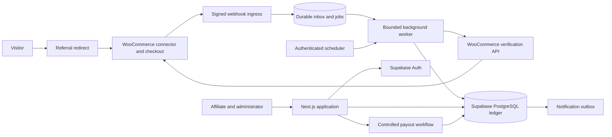
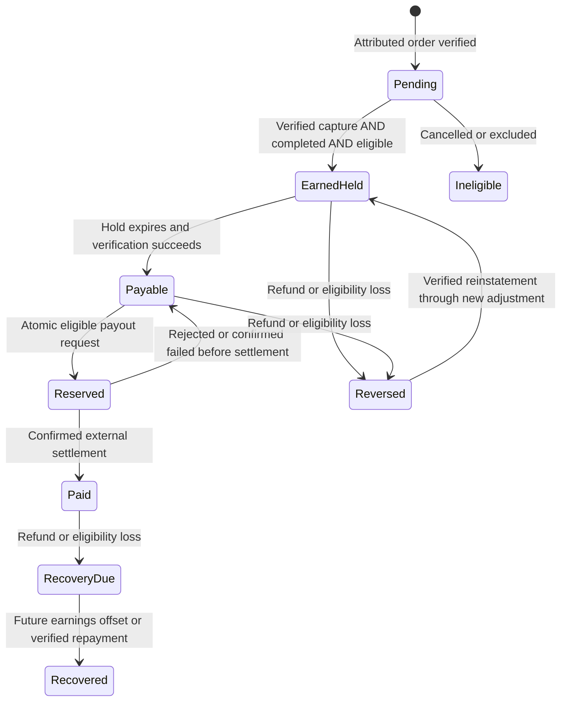
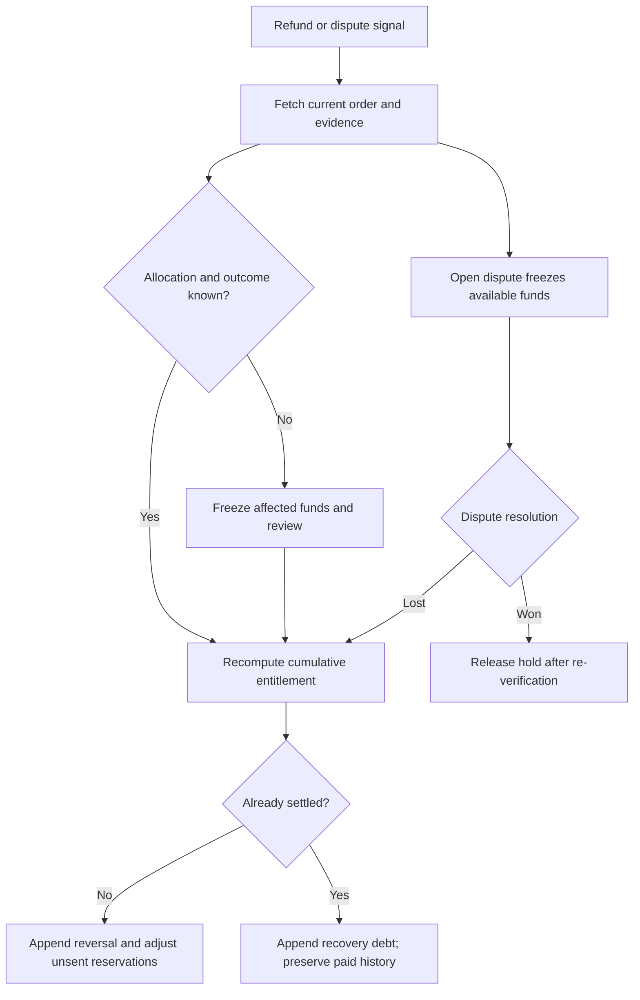

# Auto-capture connector v1.1.0 + workspace performance — October 26, 2026 (newest)

- Owner's live smoke test found the flaw: he bought through a referral link while signed in as admin, never accepted the store consent banner, and got zero tracking/commission. OWNER DECISION: no popup at all — clicking a referral link auto-captures (auto-approves). Attribution rules unchanged (first-click / 7-day / no self-referrals); the hub bridge contract is byte-identical (capture still carries `consent: true`, same keys, same HMAC).
- Connector v1.1.0 (`woo-connector/brandrep-connector/`, zip rebuilt): the banner is REMOVED entirely (no enqueue, no markup, no AJAX consent endpoint; banner JS/CSS deleted). On a `br_ref` landing the plugin sets `br_vid` + first-click `br_ref` as before, then `brc_maybe_send_capture()` itself records `br_consent=yes` (365d) and sends the capture immediately; ordinary page views retry pending captures the same way. A legacy `br_consent=no` left by the retired v1.0.0 banner is still honoured as an opt-out remnant. Order snapshot/association logic untouched — `_brandrep_consent` now reads `yes` for any referral-landing checkout, so paid linked orders associate as designed. NOT YET LIVE: the store still runs v1.0.0 until the v1.1.0 zip is uploaded/activated on cu.onetoolz.com (operator step).
- Copy sweep to the new reality ("tracking activates automatically when a referral link is clicked; no popup"): partner dashboard toolkit panel, referrals notice, /program attribution card, homepage FAQ, `/r/[code]` comment, docs/STORE_CONNECTOR §3/§4.1/§6/§7, docs/REFERRAL_BRIDGE capture paragraph, docs/LAUNCH_RUNBOOK §1.6/§1.9, woo-connector README. No rate or promise invented. No test asserted the old copy, so no test changes were needed.
- Workspace performance (owner: dashboard slow/unresponsive): (1) `requireIdentity`/`requireAccess` (`src/lib/auth/access.ts`) wrapped in React `cache()` — layout AND page each called them, doubling `auth.getUser()` + role/affiliate/MFA round-trips per navigation; now one set per request, redirects/fail-closed unchanged. (2) Sequential reads parallelized with Promise.all, each read keeping its own fail-closed try/catch: partner dashboard 4 reads, admin overview 5, referrals 2, admin settings 2. (3) New `src/app/dashboard/loading.tsx` + `src/app/admin/loading.tsx` skeletons — the AppShell now stays mounted during navigation instead of the UI freezing on the old page. (4) REGION: Vercel functions confirmed running in iad1 (US East, parent-verified from the dashboard); the repo records no Supabase region, so if the DB is not US East every read is a transcontinental round trip — aligning regions is an infra decision left to the owner (no region/env change made here). Root-layout `force-dynamic` deliberately left as-is (nonce-CSP rationale). Client bundles audited: workspace client components are only AppNav/CopyButton/CountUp (small); no change needed.
- Validation: `npm run check` PASS (582 unit tests, lint, typecheck, secret scan), `npm run build` PASS (25 routes). PHP lint unavailable in the VM (no php binary) — the PHP edits were reviewed line-by-line and brace/paren balance verified.

# Workspace dashboards + live-program polish — October 26, 2026

- The program is LIVE (store connector, bridge, webhooks, Woo ingestion/discovery and the WP-Cron worker scheduler all running in production), so the site's pre-launch framing was removed and the signed-in workspaces were rebuilt as real dashboards.
- New workspace frame: `src/app/dashboard/layout.tsx` + `src/app/admin/layout.tsx` render `src/components/app-shell.tsx` (sidebar with active-route icon nav `app-nav.tsx`, user card + sign-out, sticky topbar with a pulsing "Program live" chip). `src/components/site-chrome.tsx` suppresses the marketing header/footer on /dashboard and /admin only; /account/security and /application/status intentionally stay in the public frame (the admin AAL2 guard redirects TO /account/security, so it must not sit behind the admin layout).
- Partner dashboard: same eight metric cards and fail-closed reads (affiliate_commission_totals, affiliate_ledger_balances), payable card promoted to a hero stat; the placeholder campaign-performance table was replaced with a real campaigns panel (own referral_campaigns rows, `copy-button.tsx` copy links, Live/Paused pills) and a toolkit panel reporting the caller's store_link_status. Copy now states tracking is LIVE (first-click / 7-day / no self-referrals, consent-based capture).
- Referrals page: live-tracking notice replaces "attribution is not activated"; campaign rows with copy buttons + status pills; store-link panel functionally unchanged. Partner payouts: per-currency balance stat cards, request form, history with status pills; logic and fail-closed strings unchanged.
- Admin overview rebuilt from a link list into a real overview: pending-application count + preview, payouts awaiting action (admin_payout_queue), approved-affiliate count, active-policy card (or "Not published" + publish CTA), per-currency reconciliation status, and a standing notice that commission posting stays gated by COMMISSION_POSTING_ENABLED. Every read fails closed individually.
- Admin subpages (applications, payouts, reconciliation, settings) moved into the shell with panel styling; every form, field name and guard string preserved (policy publication test contract intact).
- Public copy sweep: footer badge "Pre-launch" -> "Live", metadata description, homepage hero/FAQ/feature copy, /program rewritten as live rules with per-card status labels, /how-it-works tense, auth aside note, revenue preview line. No rate or promise was invented: rates remain whatever the published policy says, and /program states plainly that until the first policy is published no rate applies.
- Tests: stale-copy assertions updated (revenue-dashboard x1, referral-page x2, e2e foundation x2). Validation: `npm run check` PASS (582 unit tests, lint, typecheck, secret scan), `npm run build` PASS (25 routes).

# Phase 6 dashboards completion + launch hardening — October 26, 2026 (newest)

- Phase 6 is SOURCE-BUILT (nothing installed, deployed or activated); it is the final build phase. Affiliate reporting is now real where the data exists and stays honestly unavailable where it does not.
- Affiliate ledger balances: new SOURCE-ONLY migration `20261026070000_affiliate_balances.sql` (NOT installed) adds `affiliate_ledger_balances()` (authenticated, security definer): the caller's OWN per-currency balances by bucket (held/payable/reserved/disputed/recovery), derived from `ledger.lines` credits − debits per account with the exponent taken from the account row. Platform accounts are structurally unreachable (affiliate buckets exist only on affiliate accounts). An existing account with no lines reports an exact "0"; an affiliate with no accounts gets an EMPTY set — currencies are never fabricated. Pure mapper `src/lib/ledger/balances.ts` fails closed on any drift (unknown bucket, duplicate account row, conflicting exponents). `/dashboard` renders a LEDGER BALANCES panel (formatted decimal under the recorded exponent + exact minor units) and wires exactly ONE of the eight metric cards — "Available payout balance" from the payable bucket. The other seven stay unavailable by deliberate decision: no card honestly maps to a bucket ("Pending commissions" means awaiting validation, which is not what held is — held is validated, posted and awaiting hold expiry; lifetime "Total confirmed earnings" and "Paid commissions" have no bucket source). Balances fail closed to the previous placeholders independently of the totals panel.
- Admin reconciliation: SOURCE-ONLY migration `20261026070100_admin_reconciliation.sql` adds `admin_reconciliation_overview()` (admin + AAL2, one JSONB document) and `/admin/reconciliation` (linked from the admin home). THE INVARIANT, traced through every Phase 4/5 journal flow (earn Dr expense/Cr held; reversal Dr held/Cr expense; release held→payable; reserve payable→reserved; payout release reserved→payable; settle reserved→clearing): per currency, **debits − credits on the platform expense account == credits − debits summed over held + payable + reserved + disputed + recovery + clearing**, and `differenceMinor` must be "0". Disputed/recovery are inside the destination sum so future dispute movements stay reconciled. Any out-of-flow journal funding destinations from a non-expense source breaks the identity and must surface as a mismatch — that is the check working, not noise. The overview also carries head-only calculation counts by qualification and payout counts/amounts by status. The TS mapper (`src/lib/ledger/reconciliation.ts`) RECOMPUTES the destination total and difference from the components and fails closed on any inconsistency; the page shows OK / MISMATCH per currency and instructs operators not to settle payouts on a mismatch.
- Launch hardening: new `docs/LAUNCH_RUNBOOK.md` — the operator procedure assembled only from repo facts: pre-launch checklist in dependency order (separate TEST project → every SQL suite → tracked production installs in filename order, listing the eleven uninstalled migrations → secret provisioning BY NAME from `.env.example` → flag enablement order auth → bridge → Woo → commission posting LAST and only after the settlement-evidence gate decision → store connector install/configure → administrator bootstrap per its controlled procedure → first policy publication → the full smoke path referral click → consent capture → linked order → recording → posting → hold release → payout → settlement reference → reconciliation → refund scenario), backup/restore notes (all durable state is the production Postgres; store and its plugin settings are the store's backup domain; Vercel is stateless apart from env configuration; restore drills never place production data in the shared test project), a monitoring checklist (both worker endpoints' count fields and what to watch, bridge 503 semantics, reconciliation-before-settlement, payout queue aging), and a disable-switch table for every `*_ENABLED` flag plus the connector plugin. Payouts have no enable flag of their own — with posting off, balances freeze and reserved requests remain operator-visible in `/admin/payouts`. `docs/LAUNCH_PLAN.md` gates now point at the runbook, and the stale gate-E claim that rounding/qualification controls were unbuilt is corrected.
- E2E: the foundation spec's anonymous fail-closed route list now includes `/dashboard/payouts`, `/admin/payouts` and `/admin/reconciliation` (same redirect-to-setup expectation with auth disabled).
- Rollback-only suites `supabase/tests/affiliate_balances.sql` (own-only isolation incl. cross-affiliate value leak check, bucket math across earn/release/reserve/dispute, line-free account exact zero, no-affiliate empty set, anonymous denial) and `supabase/tests/admin_reconciliation.sql` (full flow fixture reconciling to difference 0, head-only calculation counts excluding a superseded revision, payout status counts, AAL1 and non-admin denials). SQL acceptance still pending on a separate test database — not executed anywhere.
- Remaining launch blockers are all external/account actions plus one decision: provision the separate test Supabase project and run acceptance; tracked-install the eleven remaining migrations on production; provision secrets/flags securely (runbook order); install/configure the store connector; bootstrap the first real administrator (verified MFA account + operator call); publish the first policy; run the §1.9 smoke path on a naturally occurring order; commercially eligible hosting confirmation (owner-managed); and the settlement-evidence gate decision that alone unlocks `COMMISSION_POSTING_ENABLED`. Verified net-item basis in ingestion also remains open for `net_items` policy coverage (orders skip as `basis_unavailable` until then).
- Validation: `npm run check` PASS (582 unit tests, up from 546; lint, typecheck, secret scan), `npm run build` PASS (incl. the new `/admin/reconciliation` route), and `npm run test:e2e` PASS — all 38 Playwright tests (desktop + mobile), including the three new fail-closed routes.

# Phase 5 payouts: requests, reservation, review, manual settlement recording — October 26, 2026

- Payouts are SOURCE-BUILT (nothing installed, deployed or activated). New SOURCE-ONLY migration `20261026060000_payouts.sql` (NOT installed) adds a private `payouts` schema: `payout_requests` (idempotent `request_key`, currency + policy exponent snapshotted at request time, exact minor TEXT, status requested/approved/rejected/settled/cancelled/failed, external_reference, failure_reason; no delete) and append-only `payout_events` (actor/kind/detail — the audit trail replaces any updated_at). All transitions happen only inside security-definer RPCs; application roles hold no table grants.
- Money model: reservation is a JOURNAL, not a flag — request posts Dr payable / Cr reserved (`payout:<key>:reserve`), cancel/reject/fail post the single `:release` journal back, settle posts Dr reserved / Cr platform clearing under `:settle`. Because the payable balance (derived from ledger.lines as credits − debits; the ledger has no balance view) already excludes open reservations, double-spend is structurally impossible; status guards + ledger.post_journal idempotency give exactly one terminal money movement per request. All money RPCs serialize per affiliate (advisory lock). Journals flow through `payouts.post_journal`, a `payout:`-namespace security-definer delegate using the same postgres-ownership trick as `post_commission_journal`.
- Rules enforced in `request_payout`: approved affiliate only; positive exact minor amount; amount ≥ the CURRENT published policy minimum for that currency (latest `program_policies` version per currency; its decimal `minimum_payout` is converted exactly under the policy's own `currency_decimals`); sufficient payable balance. Review/settle/fail are administrator + AAL2 with maker-checker enforced in the RPC (reviewer/settler can never be the requesting affiliate's user). Settlement is RECORDING ONLY: no automated transfer exists or is authorized — an admin settles only from `approved`, only with an external reference (4–120 chars, e.g. bKash/bank txn id); same-reference replay is a no-op, a different reference conflicts. Fail (from approved) records the reason and releases the reservation.
- Reads: `affiliate_payout_overview()` (own rows only: per-currency payable/reserved exact minor, latest-policy minimum + cadence, latest 20 own requests) and `admin_payout_queue()` (admin + AAL2; requested/approved oldest first with in-schema display identity). TS: `src/lib/payouts/` (transition table mirroring the RPCs, form parsers mirroring RPC validation — the request action converts the decimal amount using the exponent from the authoritative overview, never from the form — and fail-closed overview/queue mappers), `/dashboard/payouts` (balances, per-currency request form, own history, cancel) linked from the dashboard, and `/admin/payouts` (review/settle/fail forms, own-request forms hidden) linked from the admin home. All pages fail closed to unavailable notices on any RPC error/shape drift; copy states plainly that BrandRep never sends money automatically.
- Rollback-only suite `supabase/tests/payouts.sql` covers the full lifecycle balances, minimum/insufficient denials, key idempotency + conflict, cross-affiliate isolation, non-admin and AAL1 review denials, maker-checker self-review denial, reference-required settlement and final overview/events. SQL acceptance still pending on a separate test database — not executed anywhere.
- Activation interplay (see docs/PAYOUTS.md): payouts spend `payable` balances, which only fill when Phase 4 posting releases matured holds, and COMMISSION_POSTING_ENABLED stays off until the settlement-evidence gate exists — so production requests will correctly deny as insufficient until that chain opens. Cadence is informational only; statements/reconciliation remain Phase 6.
- Validation: `npm run check` PASS and `npm run build` PASS (see delivery status for counts).

# Phase 4 calculation revisions (supersede support) — October 26, 2026

- The qualification-drift blocker is CLOSED. A calculation recorded while an order is unqualified (e.g. still processing) can now become qualified after the order completes: new SOURCE-ONLY migration `20261026050000_calculation_revisions.sql` (NOT installed) adds revision chains to `commissions.calculations` — `revision`, `supersedes_id`, `superseded_by_id` (deferrable self-FKs), unique becomes (order, policy, revision), and a partial unique index guarantees exactly one HEAD (superseded_by_id null) per chain. Append-only is preserved: DELETE/TRUNCATE still rejected, and a row-level guard trigger (mirroring `referral.guard_store_link_change`) permits exactly one UPDATE — the one-way supersede mark with every other column identical.
- `record_commission_calculation` v2 (same signature/payload + optional `supersedesEffectKey`): without the key, v1 semantics are unchanged. With it, the payload must target the current head (effect key equal), match the head's identity fields (affiliate/currency/decimals/basis/refund rule/rounding), and differ in at least one material field, else 22023. POSTED-HEAD REFUSAL: any journal under the head's effect key (earn, `:release`, `:refund:` prefix) makes the RPC raise SQLSTATE 55000 — money already moved is never rewritten by a revision; refund over-credit on a posted head remains the posting worker's credited == recorded-net invariant job. Chain operations are serialized by an advisory lock on (order, policy).
- Readers see heads only: `affiliate_commission_totals()` and `list_commission_calculations()` are head-filtered (same signatures); `commission_posting_state` needed no change (journal-keyed, and the posting worker only supplies head keys). `list_orders_for_commission_recording` was dropped/recreated: it compares against the HEAD of the highest-policy-version chain and returns the head's full recorded state (effect key, revision, affiliate, amounts, qualification, hold) for worker diffing.
- Worker: `runRecordingBatch` re-evaluates recorded heads through the same engine path as first recording; identical → `already_recorded`, material drift → revision with effect key `<base>:r<revision+1>` and `supersedesEffectKey` = head key (counted `revised`), 55000 → `supersedeRefused` (designed outcome, not an error; re-surfaces each batch while drift persists), identity/policy/evidence drift that no revision can express → `unresolvable_drift`. Result shape is now `{recorded, revised, supersedeRefused, skipped, errors}` (`updated`/`refundPendingRecheck` removed); the runner response merges `recorded`/`revised`/`supersedeRefused`. `posting.ts` and `totals.ts` needed no code changes.
- Rollback-only suite `supabase/tests/calculation_revisions.sql` (first record, supersede, totals + posting head-only, replay, no-change/stale-target conflicts, double supersede to revision 3, posted-head 55000, guard-trigger and head-index denials); SQL acceptance still pending on a separate test database — not executed anywhere.
- Validation: `npm run check` PASS (513 unit tests, up from 511; lint, typecheck, secret scan) and `npm run build` PASS (22 routes).

# Phase 4 recording worker — October 26, 2026

- Recording worker `src/lib/ledger/recording.ts` is now the first caller of `record_commission_calculation`, closing the "nothing records calculations" gap. New SOURCE-ONLY migration `20261026040000_commission_recording.sql` (NOT installed) adds two service_role-only security-definer reads: `list_orders_for_commission_recording` (decided orders with no calculation, plus recorded orders whose snapshot moved as recheck candidates; decision outcome/affiliate, stored snapshot, recorded-row comparison fields) and `list_program_policies_for_recording` (COMPLETE published history — policyForOrder fails closed on gaps; never the admin ten-row preview). Rollback-only suite `supabase/tests/commission_recording.sql`; SQL acceptance still pending on a separate test database.
- Evidence decisions (correctness over coverage, see docs/COMMISSION_ENGINE.md): order creation time = `referral.order_decisions.order_at` (bridge-supplied, RPC-validated; the stored Woo snapshot carries NO creation time and modifiedAt is never substituted). Basis: snapshot has no line items, so `net_items` policies skip as `basis_unavailable` (total refunds are never substituted for refunded-item basis); `order_total` policies record with basis = snapshot total and refunded basis = exact sum of refund magnitudes (Woo refunds are negative amounts of that same total; a positive refund total is a sign anomaly → skip). Hold days come from the immutable published `program_policies` row itself (publication copies hold_days/minimum_payout from the draft — versioned with the policy; workers never read drafts). Pre-rounding policies (NULL rounding/qualification) skip as `invalid_policy`.
- Append-only consequence: calculations cannot be updated or superseded (unique (order_id, policy_version) + record RPC refusal), so the batch records first-time calculations only (`updated` always 0) and counts recorded orders whose evidence drifted (refund growth OR qualification flip) as `refundPendingRecheck`. Refund money stays covered by the posting worker's credited == recorded-net invariant for the recorded state; qualification drift has NO handler — a row recorded unqualified can never post even after the order completes. Closing that needs a future supersede-schema decision, deliberately not invented here.
- Runner: recording now runs FIRST in `handleCommissionRunner` (recording → posting → release if budget remains) under the same fail-closed COMMISSION_* gate and worker secret; response counts gain `recorded` and `refundRecheck`. Recording deliberately rides COMMISSION_POSTING_ENABLED (single activation switch for the Phase 4 chain; its rows are the posting worker's input). Per-order isolation throughout; stored snapshots are re-validated against the stored contract before use.
- Still blocking end-to-end Phase 4 operation (beyond SQL acceptance/env): settlement-evidence gate (unchanged — COMMISSION_POSTING_ENABLED stays off), the supersede/re-recording schema decision for post-record drift, and verified net-item/refunded-item basis extraction in ingestion for net_items policies.
- Validation: `npm run check` PASS (511 unit tests, up from 498; lint, typecheck, secret scan) and `npm run build` PASS (22 routes). SQL suite is a rollback-only fixture, not executed anywhere.

# Phase 4 completion increment: posting worker, hold release, dashboard totals — October 26, 2026

- Posting surface (SOURCE-ONLY migration `20261026030000_commission_posting.sql`, NOT installed): four service_role-only security-definer RPCs are the worker's only reach into the still-closed private `ledger`/`commissions` schemas — `get_or_create_commission_accounts` (platform `expense` singleton per currency + per-affiliate `held`/`payable`; the foundation's `payable` bucket is the available balance, so release = held → payable), `post_commission_journal` (`commission:`-namespace only, delegates to `ledger.post_journal`; security-definer ownership by postgres is what passes post_journal's operator-only current_user check — service_role still cannot call it directly), `list_commission_calculations` (bounded scan + new queue/due indexes), `commission_posting_state` (earn/reversal-posted/release derived from journal lines). Delta refund reversals are standalone journals, never `journals.reverses` links — that mechanism requires exact full compensation of one journal, which a partial cumulative delta is not. Rollback-only suite `supabase/tests/commission_posting.sql`; SQL acceptance still pending on a separate test database.
- Worker `src/lib/ledger/posting.ts` + runner + `POST /api/internal/commissions/run`: consumes recorded calculations through the RPC surface only; per-item isolation; earn posts the engine net intent for QUALIFIED rows only; maintained invariant credited-to-held == recorded net (excess over the recorded net is delta-reversed, keyed by cumulative refunded basis — a refund already netted into the earn posting never reverses twice); `releaseDue` moves the credited remainder held → payable under `<effectKey>:release` only when hold_until passed and an earn journal exists. Dedicated `COMMISSION_WORKER_SECRET`, fail-closed `postingConfiguration` (COMMISSION_POSTING_ENABLED + sb_secret_ COMMISSION_SUPABASE_SECRET_KEY + exact COMMISSION_APPROVED_SUPABASE_URL + database-environment gate), soft 20s budget, counts-only responses.
- Dashboard: `/dashboard` now reads `affiliate_commission_totals()` and renders a recorded-calculations panel (pure mapper `src/lib/ledger/totals.ts`, exact minor units — the RPC carries no exponent, none invented): qualified = hold/available pipeline, unqualified = "Pending qualification estimates — NOT earnings". Any RPC error/shape drift fails closed to the previous placeholders; the eight balance cards stay unavailable (recorded totals are not ledger balances).
- Still NOT built: the calculation-recording worker (nothing calls `record_commission_calculation` yet), reversal-row persistence for post-record refund growth, dispute handling, payouts (Phase 5), SQL acceptance/installation of the three commission migrations, COMMISSION_* env provisioning + scheduling. Settlement gate: posting acts on Woo-recorded paidAt only — COMMISSION_POSTING_ENABLED must stay off until an independent settlement-evidence gate exists.
- Validation: `npm run check` PASS (498 unit tests, up from 459; lint, typecheck, secret scan) and `npm run build` PASS (22 routes, incl. the new commissions run route). SQL suites are rollback-only fixtures, not executed anywhere.

# Phase 4 foundation: policy rounding/qualification, commission engine, calculation persistence — October 26, 2026

- Policy completion (SOURCE-ONLY migration `20261026020000_policy_rounding_qualification.sql`, NOT installed anywhere): `program_policies` gains nullable `rounding` (`half_up`|`down`) and `qualification` (`paid_completed` only); rows published earlier keep NULL for both and the admin history renders them as "not recorded" — never backfilled or assumed. The old 7-argument `publish_program_policy` is dropped and replaced with a 9-argument version (same admin + AAL2 posture, serialized publication, latest-draft/stale checks, identical-request idempotency now also comparing the two new fields; the existing table constraint still enforces minimum-payout precision). `parsePolicyPublication` requires both fields, the publish action passes `p_rounding`/`p_qualification`, and the `/admin/settings` publish form has required Rounding and Qualification selects with help text: a completed status alone never earns, and PipraPay settlement evidence remains a separate gate. `supabase/tests/program_policy_publication.sql` moved to the 9-argument signature with an invalid-rounding denial case.
- Pure commission engine `src/lib/ledger/engine.ts` (no DB access, posts nothing): `EnginePolicy` pins rounding/qualification/hold days to the published policy — callers never choose rounding. `evaluateOrder` returns skip reasons (unattributed / no_policy / invalid_policy / invalid_order / currency_mismatch / zero_basis) or a calculation with `holdUntil = createdAt + holdDays` under effect key `commission:order:{orderId}:policy:{version}`. Qualification is `paid_completed` only: completed status AND a paid timestamp; otherwise the record is an unqualified pending estimate (`not_completed` / `not_paid`), never an earning, and the journal-intent builder refuses it. `recomputeForRefund` reuses `calculateCommission` on the prior quote so sequential refund reversals sum exactly to the total (no drift); earn/reversal journal intents pass `validateJournal`, zero amounts yield null.
- Persistence (SOURCE-ONLY migration `20261026020100_commission_calculations.sql`, NOT installed): private `commissions` schema, append-only `commissions.calculations` (RLS on, no anon/authenticated grants, minor amounts as TEXT, status only `recorded`, unique effect key and (order, policy version)); service-role-only `record_commission_calculation(jsonb)` with ledger-style idempotency/conflict errors; authenticated `affiliate_commission_totals()` aggregating only the caller's own affiliate rows (calculations store `affiliates.id`, resolved via `affiliates.user_id = auth.uid()`). Rollback-only suite `supabase/tests/commission_calculations.sql`; SQL acceptance still pending on a separate test database. Full detail in `docs/COMMISSION_ENGINE.md`.
- NOT built (Phase 4 remainder): posting worker (nothing calls `record_commission_calculation` or `ledger.post_journal`), hold-release job, reversal-row persistence flow, dashboard balance reads (`/dashboard` still shows unavailable placeholders), and settlement-evidence qualification beyond Woo-recorded `paidAt`.
- Repair note: these tracked-file changes were built and verified once, then lost to a `git reset --hard` in the parent session before pushing; the untracked new files (engine, both migrations, engine/accounting docs and suites) survived, and the tracked-file changes were re-applied exactly as designed and re-verified.
- Validation: `npm run check` PASS (459 unit tests, up from 436; lint, typecheck, secret scan) and `npm run build` PASS (21 routes). Phase 4 remains in progress, not complete; nothing was installed, deployed or activated.

# Phase 3 hub-side increment: br_ref handoff + buyer store-link tokens — October 26, 2026

- `/r/[code]` now appends `br_ref=<code>` (URL API) to the resolved fixed-store destination before the 302. Hub still sets no cookies and writes no click evidence; the store connector owns consent, its first-party cookie and bridge captures. Unit route test asserts the exact Location; the e2e referrals suite runs with storage disabled so it documents the handoff there and keeps its fail-closed expectations.
- Buyer identity for the bridge no longer requires a live Supabase session at order time. New `src/lib/referrals/link-token.ts`: tokens are `brlink_` + 64 hex from crypto random bytes; `hashToken` is SHA-256 hex; strict parse/validate helpers. Plaintext is generated in the dashboard server action, shown exactly once via the protected no-store referrals page (`?token=` after redirect), and never stored — storage keeps only the hash.
- New SOURCE-ONLY migration `20261026010000_referral_store_links.sql` (depends on the referral evidence migration; NOT installed anywhere): private `referral.store_links` (hash unique, partial unique index = one active link per user, RLS on, all grants revoked), guard trigger permitting only the one-way revoke transition, and RPCs — `create_store_link(p_token_hash)` authenticated + confirmed email, revokes the caller's previous active link then inserts; `revoke_store_link()` authenticated; `resolve_store_link(p_token_hash)` service_role only, active links only; `store_link_status()` authenticated, returns one (active, created_at) row so the dashboard never touches the private table. Rollback-only suite `supabase/tests/referral_store_links.sql` covers create/status/resolve/replace/revoke/cross-user/unconfirmed/anon/service denials and the guard trigger; SQL acceptance is still pending on a separate test database.
- Bridge route: `buyerIdentity` resolves `brlink_` bearers by hashing and calling `resolve_store_link` with the existing service client; all other bearers keep the Supabase getUser + confirmed-email path. The association RPC still re-checks confirmed email. Dashboard `/dashboard/referrals` gains a "Link your OneToolz store account" section (generate / regenerate+revoke / revoke, active-status display, fail-closed when storage is unavailable).
- New `docs/STORE_CONNECTOR.md` is the full store-plugin protocol (handoff, cookie/consent, exact bridge envelopes/headers, link-token flow, response handling, retry/idempotency); `docs/REFERRAL_BRIDGE.md` buyer-proof paragraphs and migration order updated for link tokens. Store plugin itself, migration acceptance/install and activation remain pending — no live service was contacted and no migration was installed.
- Validation: `npm run check` PASS (436 unit tests, up from 411; lint, typecheck, secret scan) and `npm run build` PASS (21 routes). Phase 3 remains in progress, not complete.

# Documentation classification fix — October 25, 2026

Follow-up to the authoritative production correction below (October 16): a full audit found current-guidance documents still presenting the mistaken nonproduction label as present fact, including `docs/LIVE_AUTH_TESTING.md` instructing operators to set `E2E_SUPABASE_PROJECT_REF=nwgdzzpcbqmfqujycpqk` (the PRODUCTION project) as the live-auth test target — the code rejects it, the doc told operators to use it. Fixed in place: LIVE_AUTH_TESTING (placeholder test ref + explicit never-production warning), REFERRAL_BRIDGE (production-mode project rule corrected to match `databaseEnvironmentAllowed`), README, LAUNCH_PLAN (incl. gate B: production DB already exists; a separate TEST project is what must be provisioned), WOO_INGESTION, PROGRAM_SETTINGS, COMMISSION_ACCOUNTING, DELIVERY_STATUS current-state entries, and correction banners on LEDGER_FOUNDATION, DATABASE_SETUP and the supabase/tests concurrency runbooks. Dated historical entries in this file and in DELIVERY_STATUS remain unchanged as a log; they are superseded by their correction banners. No code, schema, data or activation changes. Validation at HEAD before this fix: `npm run check` (411 unit tests, lint, typecheck, secret scan) and production build both passed.

# PRODUCTION DATABASE CORRECTION — authoritative October 16, 2026

Owner confirms nwgdzzpcbqmfqujycpqk is PRODUCTION. All earlier nonproduction classifications below are incorrect/historical. Never run synthetic identities, rollback fixture suites, concurrency clones or test harnesses against it. Previous rollback SQL tests DID occur under mistaken classification; earlier zero-fixture postcheck is not proof production was untouched. Current increment read-only audit: seven migrations, 17 RLS tables, zero policies/drafts/Woo orders, referral tables absent. Production gates now accept explicitly configured production, deny local/staging/preview misuse; Woo requires exact WOO_APPROVED_SUPABASE_URL. Live-auth harness rejects this project. No activation or production write this increment. See docs/PRODUCTION_HANDOFF.md. Separate test database needed for SQL acceptance, not a replacement production DB. Continue source work; admin supplies business values via dashboard.

# Database connection and commission foundation — October 16, 2026 (historical; classification superseded)

Supabase connection verified ACTIVE; sole visible project nwgdzzpcbqmfqujycpqk remains nonproduction. Six prior migrations untouched. Policy publication installed as 20261016114552 after rollback rehearsal; installed RPC acceptance passed, synthetic fixtures rolled back, policies/drafts 0, application count unchanged 1, Woo orders 0. Local filename aligned to assigned version: do not replay. No production connection/activation or hosting changes. Referral migrations remain source-only/unaccepted; independent-session publication races outstanding. Added offline nonposting commission arithmetic/policy selection with 41 focused tests; no earning worker or transfers. See docs/COMMISSION_ACCOUNTING.md for next integration gates. Admin—not owner-provided constants—configures commercial rules.

# Admin policy correction — October 16, 2026 (earlier source checkpoint)

Commission rates, basis and payout settings are admin-dashboard configuration, not values the owner must supply before coding can continue. `/admin/settings` now has source for explicit publication of the latest draft into immutable policy versions with admin/MFA authorization, immediate effective time, retry/conflict protection and no financial defaults. Migration `20261016190000_program_policy_publication.sql` and rollback SQL acceptance are source-only/unexecuted. Published policies are not yet consumed by calculations or transfers; do not claim active earnings. Existing attribution integration blockers remain separate from configurable business rules.

# OneToolz Affiliate Platform — Planning Memory

## Approved attribution / evidence increment — newest
- Owner approved no self-referrals, 7 days, FIRST-click credit. Encoded as first-click-7d-no-self-v1; no later-touch fallback for a self-referral winner. No commission rates/earning/payout rules approved.
- Added signed inbound bridge /api/referrals/bridge and source migration 20261016170000_referral_evidence (depends on still-source-only 20261016120000 campaigns). Private append-only policy/receipts/touches/order decisions; first-touch window doesn't extend; verified existing Woo order and independently verified buyer token required.
- Source only, NOT live: no migration installs, store plugin/consent cookie adapter, production credentials/flags or hosting changes. Requires secure buyer/store linking; guests/unlinked identities deny. SQL/concurrency and end-to-end acceptance still pending; docs/REFERRAL_BRIDGE.md is protocol/trust-boundary reference. Current phase 3/6 remains in progress, not phase 4 complete.
- Final local validation: 339 unit tests, 32 desktop/mobile browser tests, full lint, TypeScript check, heuristic secret scan and production build passed. Early process launches were interrupted; direct-node final checks established results. No production fixture execution.

## Phase 3 source implementation — current
- Owner reports production is set and requests next phase; owner manages Vercel. No remote setup or production fixture execution authorized/needed for this source increment.
- Added protected campaign management, opaque immutable links, public fixed-store routing, additive source-only migration 20261016120000_referral_campaigns and pure explicit-policy attribution resolver. See docs/REFERRAL_ATTRIBUTION.md.
- Phase 3 IN PROGRESS: links route only; no cookies/click persistence/checkout bridge/order association. New migration NOT installed; SQL/concurrency and signed-in acceptance remain unverified. Existing Woo source still refuses production; do not silently bypass it. No money features activated.
- Phase-3 local validation passed: lint/typecheck, 296 unit tests, heuristic secret scan, production build and 30 desktop/mobile browser tests. No remote database/store mutation; remaining policy/store bridge/association requirements in docs/REFERRAL_ATTRIBUTION.md.

## Deployment ownership clarification — authoritative
- User confirms Vercel hosting is already handled. Agent scope is implementation, validation, Git commits and ordinary pushes to main. Do not investigate/reconfigure hosting, DNS or accounts unless specifically requested.
- Earlier CLI account observations do not describe the user's deployment and must not be treated as a development blocker. Hosting is user-reported complete, not independently verified by the agent.
- Continue remaining application/backend work; distinguish shipped source from verified live financial functionality.

## Live-release request / connector installation — 2026-10-16 (supersedes older states)
- User asks to make all live and plan remaining build; deployment work may resume, but do not purchase/upgrade, invent financial rules or transfer money.
- Vercel CLI verified: connected rions-projects-5814501e team is Hobby; complete project list has no BrandRep. Commercial hosting eligibility blocks launch; no deployment/project creation/DNS change. Custom-domain request failed DNS locally; do not assume global absence or change records blindly.
- d1d1fad GitHub Actions verified success. Existing Supabase remains healthy nonproduction, connection reverified, session swim; one preexisting application preserved.
- INSTALLED tracked Woo migrations 20261016080655 ingestion + 20261016080727 discovery. Renamed local files/references. Both installed RPC rollback acceptance suites passed; cleanup verified zero Woo events/jobs/orders/attempts, pristine singleton checkpoint, five RLS tables. Migration history six entries. Do not rerun migrations or previously completed concurrency tests.
- No production store reads/mutations, credentials injection or flag changes. Production support requires explicit code/config design: existing Woo code only accepts local/staging + fixed nonproduction project.
- Concrete gates/remaining implementation/owner inputs in docs/LAUNCH_PLAN.md. Current phase 2/6; public pre-launch can precede accounts, ingestion and earning/payout activation.
- Post-install lint/typecheck, 233 unit tests and heuristic secret scan passed; emitter regressions validate new filenames. Runtime unchanged, so production build/browser suites not rerun this increment.

## Revenue Engine redesign — 2026-10-16
- Phase 2 of 6 remains current. Added dark financial design system, Next-hosted typography, illustrative hero, four-stage flow, independent scenario calculator, viewport reveals and reduced-motion support.
- Protected dashboard now presents unavailable metric cards/campaign/payout states; affiliate authorization unchanged. Application grouped visually; existing submission schema/RPC untouched. Program checklist documents unpublished rules.
- No real data fabricated. No database install, Woo activation, store mutation or Vercel deployment performed. Owner retains deployment responsibility.
- Integration scope/limitations recorded in docs/REVENUE_ENGINE.md; structured application fields and policy consent remain pending schema and policy approval.
- Validation passed: 233 unit tests, 26 desktop/mobile browser tests, lint/typecheck, heuristic secret-pattern scan and production build. Signed-in hosted acceptance remains unverified. Existing Vite format warning is nonblocking.
- Prior published commit b793c78 Actions run 38837066180 verified successful via GitHub API. New redesign CI must be checked separately after push.

## GitHub repository selected
- Initial application commit successfully pushed to origin/main. Remote configured to the user-provided repository; subsequent work can use normal non-force pushes. No Vercel deployment or database changes. Hosted Actions result unverified.
- User supplied rashedulislamrion/onetoolz-brandrep. Remote read succeeded and returned no refs (empty repository). Git credential manager is available; gh is not required.
- Preparing initial main-branch commit/push with ignored local credentials/artifacts excluded. No user Git author identity configured; use an explicit coding-agent commit identity rather than inventing the user's email. Owner will perform Vercel deployment.

## GitHub-first handoff and opportunity branding
- Validation completed: 219 unit tests, lint, typecheck, heuristic secret scan, production build and 24 desktop/mobile browser tests passed, including FAQ interaction, registration navigation and reduced-motion assertions. No GitHub push or deployment performed.
- User changed deployment workflow: publish to GitHub first; USER will handle Vercel. Stop Vercel deployment work unless asked again. Domain remains brandrep.onetoolz.com.
- User wants an energetic earning-opportunity experience, registration conversion, main-store promotion and motion. Implemented first public redesign pass: opportunity hero/journey art, audience strip, steps, store section, accessible native FAQs, registration CTAs, responsive styling and reduced-motion fallback; updated navigation, account introduction, how-it-works and metadata.
- Do not claim easy/guaranteed earnings, invent rates or hide current pre-launch status. Financial features remain unimplemented.
- GitHub remote absent; gh executable unavailable; tool search returned unrelated GitLab tools, not usable GitHub access. Need user's GitHub repository URL/access before pushing. Never publish .local or environment secrets.

## Hosting target confirmed
- Vercel login VERIFIED: rashedulislamrion; accessible team rions-projects-5814501e (Rion's projects), currently Hobby. Official Vercel Hobby documentation restricts commercial use. Commercial deployment needs an eligible plan/team; do not purchase/upgrade without authorization. No deployment or domain changes performed at this checkpoint.
- User selected Vercel and brandrep.onetoolz.com. Do not ask hosting choice again.
- DNS inspection currently resolves brandrep.onetoolz.com to 15.235.151.37; do not replace DNS before deployment verification.
- Added explicit .vercelignore for local credentials/artifacts. Vercel account access check initiated; deployment not yet verified. Tool discovery returned unrelated Supabase hostname tools; do not use those to configure the frontend domain.

## Launch priority and reporting requirement
- User explicitly wants faster visible delivery and live deployment, not repeated testing-only increments. Report numbered phase, built, installed/live, remaining scope and blockers at every completion.
- Six-phase reporting baseline added to DELIVERY_STATUS: 1 accounts/admin, 2 Woo + deployment (current), 3 attribution, 4 commissions, 5 disbursements, 6 dashboards/launch. Phase 1 still has deployment/auth launch acceptance gaps; do not call everything complete.
- Deployment inspection found no Git remote, hosting project config/link or Vercel CLI. Tool search returned no usable Vercel tool. Resolve hosting/account/domain; do not connect unrelated Prisma toolkit returned by search.
- Latest request authorizes moving toward launch, not invented financial rules or automatic payment transfers. Next substantive database action remains accepted connector migration installation, not more rehearsal.

## Woo independent-session acceptance complete
- Supabase connection active, session `pile`. Seven genuine two-session pairs passed with distinct backend PIDs and observed blocking; evidence and limitations in `supabase/tests/woo_concurrency.md`.
- Disposable migration-derived schema only; duplicates, worker/discovery exclusive claims, concurrent generation, expired/replaced tokens, stale snapshots, atomic discovery visibility and webhook/discovery insertion collision tested. Additional checkpoint constraint failure proved insert rollback.
- Fixture dropped and cleanup verified: fixture/real Woo schema and real claim RPC absent; migration history unchanged at four. No production requests or activation changes.
- Added offline fixture SQL emitter and regression test. NEXT: tracked connector installation on confirmed nonproduction and installed RPC acceptance. Do not repeat completed concurrency testing as if outstanding. Live/browser acceptance is separate.
- Validation: 219 tests, lint/typecheck and heuristic secret scan passed; no runtime changes and no production build rerun this increment. Previous production build passed.

## Combined Woo database rehearsal accepted
- Supabase connection reverified active; session `kids`. Confirmed installed history still identity/bootstrap/ledger/settings only.
- Both connector migration bodies and both existing SQL suites executed together in one rollback-only transaction; embedded BEGIN/COMMIT/ROLLBACK removed. Result `rollback_verified=true`; no Woo schema persisted. Execution log `log_f0ktXJZ556pL`.
- Added offline `scripts/woo-rehearsal.mjs` SQL composer and source-body/transaction-boundary regression test. Secret scanner now includes .mts and .sql.
- Genuine independent-session races still outstanding; do not mistake sequential lease tests for concurrency acceptance. Neither connector migration installed. Production credentials/approval/deployment flags unchanged; no store requests.
- Validation complete: 218 tests, lint/typecheck, expanded heuristic secret scan and production build passed (both exit 0). Separate database postcheck confirmed schema/RPC cleanup and unchanged four-entry migration history.

## Readiness CLI module warning fixed
- Renamed readiness.ts to readiness.mts and updated CLI/test imports; explicitly included .mts in tsconfig and allowed TypeScript extension imports under existing noEmit configuration. Did not change package-wide module type or suppress warnings.
- npm run check:woo now emits no MODULE_TYPELESS_PACKAGE_JSON warning; still exits 1 because configuration is incomplete, as intended. Added real subprocess regression test. npm run check passed: 217 tests, lint/typecheck and heuristic secret scan. Production build not rerun for this CLI-only correction. Existing Vite config warning is separate and remains.
- No credentials, verification flags, deployment settings or production store state changed.

## Latest: production store confirmed / offline readiness
- Validation: npm run check and build exited 0; 216 unit tests, lint/typecheck and heuristic secret scan passed. Offline readiness command ran and correctly reported blocked configuration. Node emits a nonfatal module-type warning for the standalone TypeScript import; no package-wide module mode change was made.
- User explicitly confirms cu.onetoolz.com is production; asks whether snippets are needed. No PHP snippet needed for current REST/webhook connector. Future attribution integration remains unbuilt and separate.
- Added required WOO_PRODUCTION_STORE_ACCESS_APPROVED gate to ingestionConfiguration, default false. No activation flags changed, no production requests or store mutations. Existing local/staging and nonproduction DB restrictions remain.
- Added npm run check:woo (Node 24 offline report), src/lib/woocommerce/readiness.ts and tests. Reports booleans and external requirements, never values. Configuration passing is NOT deployment readiness; real credential validity/permissions and DB state require independent checks.
- Offline command executed successfully and reported configuration blocked as expected. Secure credentials, combined SQL/concurrency acceptance, deployment, scheduling and production-data handling approval remain outstanding.

## Latest activation request / ping support
- Validation complete: npm run check/build exit 0, 213 unit tests including 18 new ping cases, lint/typecheck/heuristic secret scan passed. No live ping or deployment acceptance claimed.
- User asked to activate all and build next. Audit found five local Woo credential variables absent, all Woo switches unset, store verification unset. Hosted history rechecked using active Supabase connection/session stay: only identity/bootstrap/ledger/settings installed. No activation or hosted writes performed.
- Added strict form-encoded unsigned Woo activation ping acknowledgement (64-byte body, only webhook_id positive integer, no x-wc-webhook headers); returns 200/no-store and never persists/queues. JSON order notifications remain HMAC-required. Existing route configuration gates remain unchanged.
- Added isolated ping tests. Keep honest distinction: ping acknowledgement is reachability only, not authenticated store verification. Live deployment, SQL acceptance and secure credential provisioning still required; no commissions/payout activation possible yet.

## Latest: Woo missed-order discovery implementation
- Added bounded ID-only discovery fetcher and worker adapter; runner admits one page when WOO_DISCOVERY_ENABLED=true (defaults false). Discovery failure returns redacted 503 while allowing refreshes within remaining soft budget.
- Prepared 20261015170000_woo_discovery.sql: singleton leased checkpoint, fixed UTC scan cutoff, atomic missing-job insertion/checkpoint advancement, duplicate IDs do not alter existing jobs, hourly completed-scan cooldown and expired-lease restart from page 1.
- Discovery and ingestion migrations remain UNAPPLIED. Added supabase/tests/woo_discovery.sql; SQL suite has NOT run yet. No hosted changes or store requests in this increment.
- Offset pagination can shift during source changes; repeated full sweeps offer eventual recovery under stable data, not snapshot completeness. Failed scans restart after lease expiry. Monitoring and large-store scaling remain open.
- Local check AND production build exited 0 with 195 unit tests (29 additional discovery/runner cases), lint/typecheck and heuristic secret scan. No browser/live ingestion acceptance claimed.

Date: 2026-10-15
Status: ARCHITECTURE APPROVED by user; Phase 1 local foundation implemented and tested. Full Phase 1 acceptance is BLOCKED on isolated provider authentication and remaining security gates. Commercial settings and external resources remain unconfirmed.

## Resume instructions and verified context
- Read this file before resuming. Architecture was approved in the subsequent user message "approved, start now". Do not ask for architecture approval again; collect missing material business decisions before integration/finance work.
- User requests a production-ready independent affiliate platform for an existing WordPress/WooCommerce store; WooCommerce remains ecommerce source of truth.
- Workspace `F:\My VS Project\OneToolz Affiliates` was inspected read-only and empty before this file was created. No repository, dependencies, application, credentials, integration, or deployments were verified.
- Original planning-only restriction ended when user approved implementation. Local Phase 1 implementation is now authorized; production configuration/deployment is not performed.
- Original preferences: Next.js/TypeScript, Vercel, Supabase, Tailwind and shadcn/ui. Consult the current package manifest and implementation notes below for installed dependencies; shadcn/ui has not been installed.
- No application tests can run yet. Documentation verification is not application validation.

## 1. Executive architecture
- Modular monolith: Next.js App Router + TypeScript on Vercel; Supabase Auth/PostgreSQL; proposed Tailwind/shadcn UI.
- Minimal custom WooCommerce connector for referral capture, trusted order metadata, gateway evidence and refund/dispute signals. It is not a traditional affiliate plugin: no affiliate accounts, commission engine or payouts in WordPress.
- WooCommerce authoritative for products, orders, payment/refund facts; platform authoritative for affiliate policies, attribution decisions, ledger and payouts.
- Durable webhook inbox plus transactional jobs/outbox in PostgreSQL. Supabase logged Queues are an alternative behind a queue interface. Short authenticated scheduled worker invocations; no fire-and-forget request work.
- Pure TypeScript calculation engine; narrowly privileged database transactions enforce locking, posting and payout constraints.
- One store at launch; store_id namespaces external IDs, not a multi-tenant product.

## 2. Assumptions, defaults and unresolved decisions
- Proposed defaults: manual affiliate approval; 30-day last valid click; ordinary direct visits do not overwrite; coupon attribution off; no lifetime attribution or automatic renewal commissions.
- Commissions: verified paid AND completed; net discounted eligible item totals excluding tax/shipping/fees; product > category > global rules with explicit category priority and ambiguity rejection.
- Pin policy and product/category snapshots at order creation. Missing historical policy/evidence requires review, not invented data.
- Commission rate itself needs business approval; examples are not actual configured rates.
- Proposed hold: 30 days after eligibility, increased to fit actual refund policy. Manual monthly payouts, threshold configured in launch currency. No FX conversion at launch.
- Allow new repeat orders only with a fresh/unexpired qualifying attribution; renewals excluded unless specifically approved.
- Suspension blocks new attribution and payouts; historical liabilities remain. No retroactive forfeiture without explicit evidence and adjustment.
- Essential questions: approve custom connector and identify domains/checkout type/gateways/subscription extension; currency/rate/refund window/renewals; payout countries/method/minimum; coupon attribution preference; operating/customer jurisdictions.
- Brand assets, volume and paid infrastructure budget are unknown; obtain during discovery.

## 3. Architecture diagram


## 4. Flows
- Visitor: referral redirect -> short-lived signed handoff -> store validates -> consent-aware first-party attribution -> checkout snapshots metadata -> webhook -> verification -> eligibility/ledger.
- Affiliate: register/verify email -> apply -> await approval -> promote -> inspect private aggregate/order/ledger records -> verified payout method -> request -> reservation -> review -> settlement.
- Administrator: MFA -> review affiliates/policies -> monitor integration -> investigate discrepancies/fraud -> reasoned adjustments -> payout approval and settlement -> audit/export.
- Reject/suspend/reinstate and payment-method changes have notifications and history; changing payout details freezes payout eligibility for review/cooldown.

## 5. Integration
- Raw-body base64 HMAC-SHA256 validation with per-store Woo secret, constant-time compare, TLS, size limits and schema validation.
- Store route resolves registered origin/secret; never trust payload URLs. Standard Woo signatures do not supply freshness protection; custom connector requests add timestamp/nonce/signature.
- Persist authenticated envelope and enqueue atomically before 2xx. Duplicate persisted delivery -> 2xx. Database failure -> non-2xx. Handle setup ping separately without fabricating an order.
- Identity: store + webhook + delivery ID when present, body hash for diagnostics; semantic dedup at order snapshot and financial effect layers. Headers are not trusted proof of event identity.
- order.created/order.updated plus tested connector refund hooks. Verify installed-version native topic support; never assume refund.created universally exists.
- Serialized per-order refresh leases/fencing prevent stale workers overwriting newer fetches. Fetch current Woo order/refunds/payment evidence; reject inconsistent snapshots and retry.
- API credentials read-only where possible; gateway/dispute evidence optional connector integration. date_paid/status/transaction ID alone do not universally prove capture.
- Gateway adapter declares captured/settled evidence, pending/authorized/unpaid/disputed/unknown states. Offline/manual payments require recorded authorized verification. No adapter/evidence -> blocked.
- Retry exponential backoff+jitter; respect 429/Retry-After; dead-letter and alert; durable recovery after crash. Woo may disable failing webhooks, so monitor status.
- Reconcile incremental modified-order windows with overlap and persistent pagination; separately sweep refunds, unpaid/unsettled and previously paid orders for late changes. Full scheduled audits and manual date/order ranges.
- Never infer zero orders/refunds from incomplete pagination or API errors. Preview discrepancy repair; run repairs through normal idempotent processing.

## 6. Commission and ledger
- Pending is an estimate, not an earned liability. Earned requires approved attribution + positive eligible basis + gateway-verified paid + completed + policy eligibility.
- Hold expiry and fresh verification release earned to payable; disputes block release and payouts. Paid means externally confirmed settlement allocated to ledger lots.
- Separate entitlement, availability, settlement and dispute dimensions; partial refunds/payouts cannot be modeled safely as one status enum.
- Eligibility loss -> compensating reversal; reinstatement -> new positive adjustment after verification, not mutation. Technical regression completed->processing triggers reversal under default strict rule; gateway-specific exceptions need approved policies.
- Freeze rule version/basis/rate/rounding/currency/exponent at order creation. Percent use integer/rational exact arithmetic; currency rounding half-up per item. Fixed per-unit and fixed per-order are distinct rule types. No implicit stacking.
- Itemized refund adjusts matching line's net eligible basis; recompute cumulative remaining entitlement and post delta to avoid repeated rounding drift. Fixed per-unit prorates monetary item refunds, removes units for quantity returns; fixed-order prorates original eligible basis unless approved otherwise.
- Ambiguous amount-only refund -> freeze remaining order-linked payable funds, open review, prohibit payout until allocation resolves. Full refunds reverse all entitlement. API outage never treated as no refund.
- After-paid reversal preserves settlement and creates debt/recovery; offset future available earnings under disclosed terms. Do not initiate bank debit automatically.
- Proposed double-entry subledger: platform expense/clearing; affiliate held/payable/reserved/disputed/recovery accounts. Every journal balances by currency. Original payout allocations remain immutable.
- Append-only journal transactions/lines, calculation versions, financial adjustments and audit events; mutable read projections can be rebuilt.
- Payout request atomically locks affiliate/currency accounts and lots, checks fresh reconciliation, debt, holds, active status and threshold, and reserves funds. All outbound transitions idempotent.
- Payout states: requested/reserved -> approved -> sending -> paid; rejection/cancellation/failure releases safe reservations. Unknown provider outcome stays reserved and investigated; never blind-resend.
- Refund concurrent with payout: cancel/reduce unsent reservation; if sending/outcome unknown preserve reservation and record recoverable debt pending reconciliation. Recheck just before send, but never promise atomicity with external gateways.
- Illustrative only: 100.00 eligible at 10% -> 10.00 earned; 25.00 eligible refund -> 2.50 reversal; full refund leaves 0 entitlement; if 10.00 already paid, 10.00 recovery remains until offsets/repayment.

## 7. Schema blueprint
- UUID internal PKs; external Woo IDs bigint; monetary values signed bigint minor units + ISO currency + exponent; exact decimal strings from Woo never floating point. Rate numeric(12,8) or integer basis points. UTC timestamptz; business dates explicit timezone.
- profiles(id FK auth.users), user_roles(user_id,role composite unique), affiliate_applications(user_id,status), application_events(application_id,actor_id,reason).
- affiliates(user_id unique,status), referral_codes(affiliate_id,normalized_code unique,retired_at), stores(origin unique), coupon_mappings(store_id,external_coupon_id unique within store,affiliate_id,effective dates).
- referral_clicks(affiliate_id,store_id,token_hash,created_at), attribution_sessions(token_hash unique,affiliate_id,expires_at,consent state), order_attributions(order_id unique,current decision), attribution_decisions(order_id,revision unique,source,evidence,reason,policy).
- products(store_id,woo_product_id unique within store), categories(store_id,woo_category_id), product_categories composite PK; snapshots retain sale-time metadata.
- orders(store_id,woo_order_id unique within store,currency,status,payment evidence,snapshot hash,source_modified_at), order_snapshots(order_id,revision unique), order_items(order_id,woo_item_id unique within order).
- refunds(store_id,woo_refund_id unique within store,order_id), refund_items(refund_id,order_item_id,external_refund_item_id), refund_allocations(refund_id,item_id,revision,reason).
- webhook_events(store_id,webhook_id,delivery_id,body_hash,payload_ref), event_attempts(event_id,attempt,status,error), jobs(idempotency_key unique,lease,fencing token,next_attempt_at), outbox(dedupe_key unique).
- policy_versions(version unique,effective_from,immutable terms), commission_rules(policy_id,scope,priority,type,value), rule_targets(rule_id,product/category FK).
- commissions(order_id,affiliate_id,component_key unique per order), commission_calculations(commission_id,revision unique,policy,basis,rate,result,evidence hash), commission_events(commission_id,type,reason).
- ledger_accounts(affiliate_id nullable,currency,bucket,unique account identity); journal_transactions(effect_key unique,source,reason,actor); journal_lines(transaction_id,account_id,debit_minor,credit_minor,commission_id).
- payout_methods(affiliate_id,encrypted details/provider token,verification/version), payout_requests(affiliate_id,currency,idempotency_key unique), payout_transactions(request_id,provider,reference unique within provider), payout_allocations(transaction/request,commission lot,amount), payout_events; reservation projections separate from immutable settlement allocations.
- notifications(user_id,dedupe_key,read_at), audit_events(actor,action,reason,entity,correlation_id), fraud_cases, integration_health, reconciliation_runs, reconciliation_items.
- Index all ownership/FK paths, affiliate+time, order modified time, queued jobs by status/due time, payouts by status, webhook identity and pending reconciliation. Partition clicks only when measured need arises.
- Restrict deletion of financial parents; never cascade user deletion into ledger. Cross-store/order/currency consistency enforced with composite FKs/checks and transaction functions.
- Deferred balancing constraints, immutable posting enforcement, row locks and unique effect keys guard finance; payout allocations cannot exceed reserved lots; refunds cannot over-reverse original entitlement.

## 8. Security/RLS
- Deny by default. Exposed tables: RLS + explicit grants. Affiliate reads only owned safe projections; no direct ledger, attribution, role or payout status writes.
- Raw Woo payloads, queue, customer identity, financial posting and payout secrets in private schema, no browser grants. RLS where applicable plus server-only permission boundaries.
- Service keys bypass RLS: isolate worker credentials; interactive routes normally use validated user JWT + RLS. Narrow privileged operations explicitly reauthorize in DB/server.
- Roles authoritative in protected table, not editable user metadata. Current status/permissions checked on every privileged mutation; admin MFA; payout approval step-up and maker-checker.
- Protected views use security_invoker and safe grants; ownership includes auth.uid and approved affiliate mapping. SQL security-definer functions restricted execute grants and fixed search_path.
- Validate session server-side per current Supabase SSR guidance. Do not cache private responses publicly. Cookie/CSP/CSRF/origin/input limits; MFA and cooldown for payout changes; encrypted sensitive fields and masked displays.
- Separate affiliate auth from Woo customer identities. HMAC normalized emails/customer matches for self-referral review; no raw customer information to affiliates. Shared IP alone is not proof.
- No perfect fraud prevention. Audit is append-only against app roles; external restricted archival gives tamper evidence against privileged database operators.
- Proposed click retention 90 days, raw payloads 30 days, short-lived IP signals; retention/consent/accounting/legal holds require jurisdictional review. No promise these values satisfy law.

## 9. Routes/components
- Public: /, /how-it-works, /program, /terms, /privacy, /login, /register, /forgot-password, /reset-password, /auth/callback, /r/[code].
- Affiliate: /apply, /application/status, /dashboard, /dashboard/links, /dashboard/coupons, /dashboard/conversions, /dashboard/commissions, /dashboard/payouts, /dashboard/payouts/new, /dashboard/profile, /dashboard/payout-methods, /dashboard/notifications, /dashboard/policies.
- Admin: /admin, /admin/applications, /admin/affiliates/[id], /admin/rules, /admin/products, /admin/orders/[id], /admin/attributions, /admin/commissions, /admin/ledger, /admin/refunds, /admin/payouts/[id], /admin/fraud, /admin/webhooks, /admin/reconciliation, /admin/reports, /admin/audit, /admin/settings.
- Proposed organization (not created): app route groups; features/auth,affiliates,attribution,commissions,payouts,admin; components/ui and dashboard; lib/server data access, domain services, worker handlers; tests; supabase migrations; separate connector folder.
- Server-render data, client islands for charts/forms. Shared Money, StatusBadge, DateRange, MetricCard, DataTable, LedgerTimeline, ConfirmationDialog, EmptyState, PermissionBoundary UX only.
- Brand assets unknown: proposed neutral surfaces, one approved accent, accessible focus/contrast, mobile cards, keyboard navigation, tables behind charts, reduced motion. No invented official colors.
- Metrics distinguish estimated pending, held earned, payable, reserved, paid gross, reversals and recovery. Report currency separately and define click/conversion denominator and cohort.

## 10. API contracts
- GET /r/:code validates code/destination and issues short-lived handoff; no arbitrary redirect.
- POST /api/integrations/woocommerce/:store/webhook raw HMAC + durable inbox; POST /api/integrations/woocommerce/:store/attribution signed connector request.
- GET /api/me/summary|conversions|commissions|payouts|notifications scoped affiliate DTOs; POST /api/applications; POST /api/me/links; PATCH /api/me/profile allowlisted fields.
- POST /api/me/payout-methods step-up; POST /api/me/payout-requests idempotency key and atomic reservation; PATCH /api/me/notifications/:id ownership.
- Admin endpoints under /api/admin for application decision, suspension, policy version, attribution correction, reasoned adjustment, refund resolution, payout approve/reject/settle, webhook retry, reconciliation and exports.
- Internal worker endpoints authenticated independently of user sessions. All mutations validate strict schemas, allowed state transition, amount/currency, ownership/role, reason where privileged, and audit context. Server computes authoritative amounts and identity.
- Stable errors, pagination limits, allowlisted sort/filter, optimistic concurrency version, origin/CSRF controls for session mutations, finance idempotency, CSV formula escaping and short-lived private downloads.

## 11. Attribution and fraud
- Public links use affiliate code; platform redirect mints short-lived signed token with store/audience/affiliate/click/time/expiry/nonce and allowlisted path.
- Store verifies and consumes nonce idempotently, then stores opaque host-only Secure HttpOnly SameSite=Lax attribution cookie backed by server record where consent permits. Keys separate from webhook credentials.
- Woo checkout persists signed/protected attribution and policy snapshot via Woo CRUD; support actual classic/Blocks/HPOS path verified in staging. Cached storefront needs server endpoint without caching personalized Set-Cookie.
- Checkout freezes last valid click before order creation; later clicks do not steal placed orders. Direct traffic does not overwrite; invalid/suspended affiliates ignored.
- Optional future coupon precedence: explicit eligible affiliate coupon wins over link; multiple conflicting affiliate coupons -> review/no automatic award. General coupons only reduce net basis.
- No cookie sharing across unrelated domains; no fingerprinting workaround. Cookie deletion, consent denial, ad blocking, private browsing and cross-device use cause undercount. No lifetime customer attribution default.
- Signals: click velocity, bot patterns, time to conversion, refunds, shared payout destination, self-purchase HMAC match, coupon leakage. Review/suspension documented; no automatic confiscation solely by heuristic.

## 12. Tests
- Pure arithmetic tests: discounts/tax exclusion; category priority; percent/fixed variants; zero/three-decimal currencies; rounding; policy freezes; quantity and amount-only refunds; over-refund guard.
- State/property tests: paid+completed only, unknown gateway fail closed, completion regression, reinstatement, duplicate/old events, durable retry and poison events, full/partial refund before and after payout.
- Concurrent integration tests on real PostgreSQL: duplicate webhook, worker crash/lease expiry/fencing, simultaneous refunds/payouts, double payout requests, balanced journals, insufficient funds and debt offsets.
- RLS tests anon/affiliate A/affiliate B/admin/suspended; direct API/view/RPC access; role escalation; service secret scan; no PII leaks.
- Staging Woo fixtures: actual gateways, classic/Blocks checkout as applicable, guest/login, HPOS, consent, caching, API pagination, webhook disabled/outage, subscription renewals excluded.
- End-to-end approval->referral->paid completed->hold->payout->refund; accessibility/mobile; restore drill and reconciled financial totals. Seed synthetic data only.

## 13. Deployment/operations
- After approval only: isolated local/staging/production Supabase and Woo staging, protected GitHub main, CI gates, Vercel preview without production keys, explicit migration job with expand/contract changes.
- Proposed variables only: NEXT_PUBLIC_SUPABASE_URL, NEXT_PUBLIC_SUPABASE_PUBLISHABLE_KEY; server-only Supabase secret, Woo base/read credentials/webhook secret, connector signing keys, worker secret, payout encryption key, email/monitoring credentials.
- Validate current provider key naming and SDK compatibility at implementation; public prefix never used for secrets. Keys rotated with runbooks; MFA and least privilege.
- Vercel handles UI, short APIs, ingress and bounded worker batches. Durable job state lives in PostgreSQL, not cron or process memory. Scheduler invokes work; retries are database-driven.
- Proposed SLOs: healthy webhook ingress under 2s; normal processing p95 under 2min; queue lag alert 5min; incremental reconciliation 15min, daily unsettled scan, weekly wider audit. Measure against actual traffic and API capacity.
- Proposed recovery targets RPO <=15min/RTO <=4h require funded backup/PITR and demonstrated restore; not guarantees. Back up storage separately from database; restore keys/config/runbooks; pause payouts during recovery and reconcile external transfers before restart.

## 14. Prioritized phases and gates
0. Discovery/approval: confirm store/domains/gateways/checkout/renewals/currency/payout rules; gateway evidence matrix, threat model, architecture/policy signoff. No code before approval.
1. Foundation: scaffold approved stack, local/staging config, CI/auth/roles/design tokens. Gate: build/typecheck/lint/auth smoke; secret scan; role tampering blocked; preview isolated.
2. Schema/RLS/ledger: reviewed migrations and posting functions. Gate: clean rebuild; A/B RLS tests; balanced immutable journals; duplicate/concurrent posting tests; synthetic seeds.
3. Connector/ingestion: consent-aware handoff, checkout metadata, signed durable inbox. Gate: staging classic/Blocks as applicable; tampering rejected; duplicate/crash/retry and Woo outage recovery; checkout unaffected.
4. Commission/reconciliation: payment adapters, rule snapshots, refunds/debt, stale-state handling. Gate: all arithmetic/lifecycle cases; reorder/duplicates same result; no unresolved-refund payout; reconciliation repairs omission without double awards.
5. Affiliate/admin UX: safe projections, reporting, audited workflows. Gate: mobile/keyboard/accessibility tests; metrics match ledger; no cross-affiliate or customer PII; all privileged writes audited.
6. Payouts: encrypted methods, reservations, maker-checker, manual settlement evidence. Gate: concurrent request/partial refund/send-unknown tests; no duplicate settlement; debt blocks spending; failed transfer releases only after confirmed outcome.
7. Hardening/pilot: alerts/load/restore/runbooks/privacy. Gate: restore within agreed target, no critical security findings, measured latency/capacity, real restricted pilot reconciles to Woo and payout evidence, operator signoff.
- Risks: connector compatibility, gateway evidence gaps, refund ambiguity, privacy tracking loss, external payout uncertainty, serverless/DB capacity, privileged abuse, brand/scope unknown. Alternatives: coupon-only if connector forbidden; external durable worker if queue latency/capacity demands; no microservices or automated payout provider until justified.

## 15. Implementation gate
- Recommended: Next.js/Vercel + Supabase modular monolith + minimal Woo connector + durable jobs + append-only balanced financial subledger.
- First recommended implementation phase after approval: Phase 1 foundation, only once Phase 0 business/evidence decisions are signed off.
- Before Phase 2: passing clean build/lint/typecheck/auth smoke tests, protected roles, isolated nonproduction configuration, no secret exposure, reviewed initial threat model, no live store side effects.
- Architecture approval was received after planning. Business policy amounts and live configuration are still not approved merely by architecture approval.

## Official references consulted (not local configuration evidence)
Official pages below were opened during planning. The WooCommerce REST API reference failed to load; its exact installed-version contracts must be verified during discovery. Other pages loaded. No connected accounts were accessed or configured. Tool discovery returned an unrelated account-inventory plan, which was not executed.
```text
https://woocommerce.com/document/webhooks/
https://woocommerce.github.io/code-reference/classes/WC-Webhook.html
https://woocommerce.github.io/woocommerce-rest-api-docs/
https://developer.woocommerce.com/docs/block-development/extensible-blocks/cart-and-checkout-blocks/
https://supabase.com/docs/guides/database/postgres/row-level-security
https://supabase.com/docs/guides/auth/server-side/creating-a-client
https://supabase.com/docs/guides/queues/quickstart
https://supabase.com/docs/guides/platform/backups
https://vercel.com/docs/functions/limitations
https://vercel.com/docs/cron-jobs/manage-cron-jobs
https://nextjs.org/docs/app/guides/authentication
https://developer.mozilla.org/en-US/docs/Web/HTTP/Reference/Headers/Set-Cookie
https://ico.org.uk/for-organisations/direct-marketing-and-privacy-and-electronic-communications/guide-to-pecr/cookies-and-similar-technologies/
```

## Lifecycle diagrams and additional gates
These diagrams summarize transitions; amounts can be partially in multiple states simultaneously.


- Disputed is orthogonal: confirmed open dispute freezes affected held/payable/reserved-but-unsent funds; no assumed debt until established loss. Already settled funds remain paid with disputed exposure recorded. Won disputes release/reinstate only by verified compensating events; lost disputes reverse entitlement.
- For the strict completed-status rule, re-eligibility starts a new hold by default; administrative exceptions require versioned policy and reason.
- Reference ledger posting: earn Dr platform expense / Cr affiliate held; release Dr held / Cr payable; reserve Dr payable / Cr reserved; settlement Dr reserved / Cr clearing. After-paid refund Dr affiliate recovery receivable / Cr expense recovery; future offset Dr payable / Cr recovery receivable. Reviewed accounting mapping is a pre-payout gate.
- Required policy inputs before production: actual commission rates, currency, payout minimum/method, hold/refund policy and gateway evidence. No invented monetary default is activated.
- Per-phase risks/trade-offs: P0 wrong business evidence vs discovery delay; P1 SSR/session leakage vs rapid scaffolding; P2 transactional complexity vs unsafe mutable balances; P3 connector compatibility vs weak browser-only tracking; P4 fail-closed delayed earnings vs inaccurate awards; P5 privacy-limited reporting vs customer-data exposure; P6 manual operational cost vs premature transfer automation; P7 paid operations capacity vs untested recovery.

## Implementation checkpoint — 2026-10-15
- User approved architecture and requested implementation. Created local Next.js 16.4.1 / React 19.3.1 / TypeScript 6.0.3 / Tailwind 4.3.3 foundation, Supabase SSR server client, public pages, account forms/actions, callback and protected route boundaries. Exact dependencies and lockfile are authoritative.
- Local Git initialized on main. No commit, remote, GitHub connection, hosted CI, deployment, database migration, or external service configuration performed.
- Added README, initial threat model, environment example, CI definition, secret heuristic, 28 policy/config unit tests and 16 desktop/mobile browser tests.
- Verified: npm run check PASS (lint zero warnings, route types/typecheck, 28 tests, secret pattern scan); npm run build PASS; npm run test:e2e PASS (16 tests). Production dependency audit reports zero vulnerabilities. Browser tests run against production build with authentication disabled; not real Supabase/RLS integration tests.
- Full dependency audit: five high-severity development-only findings through Next ESLint plugin/fast-glob/micromatch/braces. No unsafe forced downgrade applied. Vite emits a future native-config warning for the TypeScript test config; tests pass. npm emitted peer override warnings during tooling installation; revisit toolchain compatibility before release.
- Authentication is OFF by default. To test it, configure a dedicated nonproduction Supabase project locally using README. Do not paste server secrets into chat. No service-role credential is used in the foundation.
- Role reads expect future user_roles and affiliates tables. Missing schema denies dashboard access. No role provisioning path exists; no MFA enrollment UI exists. Admin also requires AAL2.
- No live earnings, commissions, referral tracking, applications, payouts, or WooCommerce connection implemented. Landing illustration is explicitly labeled, commercial terms unpublished, robots noindex.
- Remaining Phase 1 gate: actual register/confirm/login/logout/recovery tests, isolated environment verification, provider abuse controls plus durable application rate limiting/CAPTCHA before public signup, MFA UX/provisioning and schema/RLS integration validation. Do not call the complete affiliate platform or Phase 1 production-ready.
- Initial visual direction uses green/neutral design tokens, not verified OneToolz brand assets. shadcn/ui is not installed.
- Next work: obtain isolated Supabase project configuration and unresolved business details; implement/test remaining auth foundation before progressing to financial schema/integration phases. README contains reproducible commands.
## Local authentication setup checkpoint
- User supplied Supabase settings locally and confirmed nonproduction. Prior read-only provider check returned HTTP 200, email enabled, confirmation required, registration allowed.
- On user request to proceed, AUTH_ENABLED was set to true in ignored .env.local for APP_ENV=local / SUPABASE_ENVIRONMENT=nonproduction. Credentials were not displayed or changed.
- Application configuration validation passed; all 28 unit tests passed again. Defaults in .env.example remain disabled.
- Redirect allowlist configuration remains unverified. No real user registration, email confirmation, recovery, MFA, role schema or RLS test has been performed. Phase 1 is not fully accepted; do not skip to financial integration.
- Next step: user runs local app, registers a test account, confirms email in the same browser and signs in. Expected destination is account status, not an approved affiliate dashboard. Keep this environment local; public abuse controls remain incomplete.

## Phase 2A checkpoint — identity/application preparation
- User reports successful registration; no independent confirmation of email, MFA, or recovery flows. No email-based admin promotion performed.
- Prepared supabase/migrations/20261015000100_identity_applications.sql: profiles, user_roles, affiliates, applications, append-only history; own-row RLS; controlled verified-email submission and MFA-admin approval RPCs; no financial objects.
- Added /apply and live application status/history UI. Missing database schema fails closed. One application per user; self-approval prohibited; reasons visible to applicants.
- Added SQL integration fixture script and docs/DATABASE_SETUP.md. Neither migration nor SQL tests executed: no local Docker/PostgreSQL and no verified privileged hosted database connection. Do not claim RLS acceptance.
- Validation: lint/typecheck/secret scan PASS, 36 unit tests PASS, production build PASS, 18 desktop/mobile browser tests PASS. Browser tests explicitly disable auth; real signed-in application submission remains untested.
- Background validation command attempted a build-time AUTH_ENABLED override but shell quoting rejected that assignment; build still passed with local settings. Browser runner independently enforced disabled auth and passed. No records were created by these tests.
- Next: review/apply migration to isolated nonproduction database, execute SQL tests, test signed-in submission and cross-user isolation. MFA/admin provisioning UI, comprehensive database tests and financial ledger remain pending.

## Hosted identity migration applied — 2026-10-15
- Authorized Supabase management connection verified active; target matched configured nonproduction reference. Public schema and migration history were empty before application.
- Applied identity_applications through management migration API; provider version 20261015061714. Renamed local migration to that version to prevent CLI history mismatch. API executed equivalent SQL without file-level BEGIN/COMMIT, using its migration transaction.
- Prepared identity_rls assertions PASSED against hosted PostgreSQL in rollback transaction: duplicate submission, owner reads, cross-user denial, direct role/status mutation denial, non-admin review denial, admin AAL1 read denial, AAL2 approval, repeat approval idempotency, affiliate role creation, immutable history.
- Postcheck: five tables RLS-enabled, no authenticated direct INSERT/UPDATE/DELETE, zero fixture users, zero applications/events, zero admins. Actual registered account exists and email is confirmed. No real roles assigned.
- SQL tool returns only final query result; verification consolidated into one JSON SELECT and checked explicitly.
- Next: user can submit application at /apply. Admin provisioning/MFA UI and broader concurrency/security tests still pending; no commission/finance implementation yet.

## MFA and application review UI checkpoint — 2026-10-15
- Verified the local migration filename is 20261015061714_identity_applications.sql; no migration rerun or hosted operations performed.
- Added /account/security for manual-key TOTP enrollment and session challenge/verification. Setup never grants roles. Verified factors cannot be removed through this UI; recovery remains unimplemented and must be designed before production use.
- Added /admin/applications with paginated pending queue, applicant-visible reasons and explicit decision confirmation. Actions enforce same-origin, protected role and AAL2 before calling the existing review RPC; self-review remains prohibited in UI and database.
- Admin users without AAL2 are routed to security; ordinary users remain denied admin access.
- Validation: 39 unit tests, 22 auth-disabled browser tests, lint/typecheck/build/heuristic secret scan passed. Existing Vite config-loader warning remains nonfatal.
- No actual authenticator enrollment, signed-in review, recovery, concurrency tests or administrator bootstrap executed. No administrator granted. Next: separately authorized audited UUID-based bootstrap design, real application submission and live MFA/browser security validation. Financial integrations remain out of scope.

## Expanded tests and bootstrap preparation — 2026-10-15
- User authorized testing on their behalf and continuation. Supabase connection reverified active (session slip). Local reference matched nonproduction project; hosted history still only 20261015061714.
- Reran baseline identity_rls and added/executed identity_extended SQL suite. Both passed in rollback transactions. Anonymous/unverified denial, invalid fields, AAL1 review denial, self-review denial, rejection/idempotency/conflict handling and audit deletion denial now exercised.
- Prepared 20261015080000_administrator_bootstrap.sql and administrator_bootstrap.sql. Rehearsed BOTH together in one rollback transaction successfully. Migration DDL and fixtures rolled back: NOT permanently applied; never rename as applied or rerun identity migration.
- Bootstrap is postgres-invoker-only, disallows authenticated/service-role callers, requires confirmed active UUID plus verified TOTP, serializes role writes, allows initial grant only, writes append-only grant evidence atomically. No real admin granted. Operator reference is supplied evidence, not independently authenticated operator identity.
- Added 16 mocked MFA/review server-action tests and Vitest source alias. Validation PASS: 55 unit tests, 22 auth-disabled browser tests, lint/typecheck/build/heuristic secret scan. Nonfatal Vite config-loader warning persists.
- Verified zero test users, applications, events, or admins after database tests. No password changes, MFA resets or real application submissions performed.
- Live authenticated browser/MFA/recovery and multi-session concurrency remain unverified. Local env has only public configuration, no privileged Auth key/test-user credentials. Do not claim all tests passed or bypass enrollment by inserting real-user MFA factors.
- Next: tracked application of reviewed bootstrap migration; authorized disposable Auth test provisioning and real browser/concurrency harness; independently verified real administrator UUID and explicit grant authorization. Read docs/ADMINISTRATOR_BOOTSTRAP.md. Financial work remains gated.

## Bootstrap applied and auth-enabled anonymous browser tests — 2026-10-15
- Connection reverified active (Composio session such). Preflight found only identity migration, no bootstrap table and zero admins; project write posture enabled. Applied reviewed bootstrap migration through management API, without file-level transaction wrappers (API owns migration transaction).
- Provider assigned version 20261015102213. Local migration renamed from 20261015080000 to 20261015102213 and verified present alongside identity migration. Do not rerun either migration.
- Verified bootstrap audit RLS, security-invoker function, and no EXECUTE/table access for anon/authenticated/service_role. Reran bootstrap SQL suite against installed function: passed; zero fixtures, admins and grant events after rollback. No real role grants.
- Added playwright.auth.config.ts and tests/auth-e2e/anonymous.spec.ts, command npm run test:e2e:auth. Runs port 3200, auth enabled with local nonproduction config; no credentials, account writes, MFA changes or emails. Tests enabled login, anonymous denial on seven protected routes, and missing-code callback safety. Trace/video/screenshots off.
- Full checks PASS: 55 unit tests, 22 auth-disabled browser tests, 18 auth-enabled ANONYMOUS browser tests, lint/typecheck/build/heuristic secret scan. New suite does not prove successful provider sign-in or MFA.
- Updated README to remove obsolete unapplied-schema/MFA-absent claims, plus database/bootstrap docs. Nonfatal Vite config-loader warning remains.
- Next: disposable Auth account provisioning and live signed-in/MFA/concurrent-flow harness; real administrator UUID still requires independent verification and explicit grant authorization. Recovery, concurrency, financial integration and deployment remain incomplete.

## Live Auth harness preparation — 2026-10-15
- User selected finishing authentication acceptance before financial/store work.
- Tool discovery for Auth provisioning returned only database login-role tools, which were not used. No hosted changes or disposable accounts created this increment.
- Added opt-in playwright.live-auth.config.ts, tests/live-auth/mfa.spec.ts, test-only configuration/TOTP helpers and docs/LIVE_AUTH_TESTING.md. Command: npm run test:e2e:live-auth.
- Intended live flow: admin-API disposable confirmed account, browser password sign-in, non-admin denial, real TOTP enrollment, fresh-session challenge and sign-out, identity-checked deletion and 404 verification. No application or immutable audit records created. Ignored non-secret manifests support cleanup after crashes; retries and browser artifacts disabled.
- Harness requires explicitly injected nonproduction test-process secret key and project opt-in. No key was requested in chat, saved, or exposed. Application child receives empty E2E_SUPABASE_SECRET_KEY. Existing local env is not automatically loaded into the test runner.
- Validation: npm run check PASS (lint/typecheck, 70 unit tests, heuristic secret scan). Missing-config test discovery deliberately failed before account creation. Live test NOT RUN, build/browser suites not rerun this increment (no application runtime changes).
- Remaining: securely provision test-process key/configuration, execute live MFA harness and verify cleanup, then isolated application/review concurrency fixtures and recovery acceptance. Do not claim provider/MFA acceptance from helper unit tests.

## User-reported live MFA and ledger continuation
- User explicitly reports MFA worked in earlier live testing and requests moving on. Accept as user-reported manual verification; do not repeatedly demand the test key or block isolated development on rerunning MFA. Automated harness execution, recovery, concurrency and real-admin grant status remain separate/unverified.
- Started the next schema/RLS/ledger phase with isolated pure journal validation: exact bigint arithmetic, canonical minor-unit strings, balanced single-currency/exponent entries, one positive side per line, account UUID checks, bounded amounts and copied/frozen output.
- No database migration, posting function, account balance, commission, payout or store integration enabled. Currency syntax is not a supported-currency registry; trusted account metadata and business policy remain required.
- Added synthetic journal tests and docs/LEDGER_FOUNDATION.md. Next slice: protected ledger accounts, immutable journal schema and guarded idempotent posting with payload-conflict/concurrency tests. No real-money rules inferred from fixtures.
- Validation: npm run check passed: lint/typecheck, 97 unit tests (27 new journal tests), heuristic secret scan. Build/browser suites not rerun for this isolated, unconnected module. No hosted changes.

## Private ledger database increment — 2026-10-15
- User requested the next phase. Connection reverified active, session knew, same approved nonproduction project. Applied only ledger_foundation; provider assigned 20261015135651, local filename aligned. Do not rerun any of the three installed migrations.
- Private ledger schema: currencies/accounts/journals/lines, restrictive composite FKs, RLS with no client policies/grants, append-only update/delete/truncate guards and deferred complete/balanced snapshot checks. No currency/account seeds retained.
- Operator-only security-invoker post_journal: postgres required, exact integer validation, normalized ordered payload comparison, effect-key transaction lock, stable account locks, atomic posting, exact unique full reversal link. No app/admin/service_role posting authority.
- Rollback SQL assertions passed. First test iteration hit pending-trigger truncate guard; test order corrected. One retry had transient proxy 502; zero-row postcheck and subsequent full suite passed.
- Concurrent hosted tests used disposable schema cloned from installed migration: identical retry same UUID, conflicting retry one success/one 22023, opposite account order success. Lock waiter observed in all three cases; clone counts 4 journals/8 lines, guarded schema cleanup succeeded. Actual ledger has zero currencies/accounts/journals/lines.
- npm run check passed (97 tests, lint/typecheck, heuristic secret scan). No build/browser rerun. SQL tests and concurrency runbook saved; documentation updated.
- Next: approved store/financial discovery and ingestion design, or automated clean rebuild/database CI. Full Phase 2 acceptance is not claimed: no affiliate-facing ledger reads, commission rules, payout/lot accounting or financial integration. Auth recovery/signed-in review acceptance remain separate outstanding work; user-reported MFA remains accepted.

## Woo intake preparation — 2026-10-15
- User supplied cu.onetoolz.com, PipraPay, manual renewals only (no Woo subscriptions/automatic recurrence), authorized ingestion but no commissions/reversals/payouts.
- Public read-only inspection: checkout redirects to cart when empty; checkout page 9 has Elementor shortcode/Woo markup; CartFlows namespace exists; cart metadata lists piprapay. Gateway API 401. Actual checkout flow and installed gateway plugin/version remain unverified. Store not confirmed staging. Tool discovery session nest returned unrelated tools, none executed.
- Added disabled webhook receiver, signature/body limit tests, minimal event DTO, source order projection and injected worker tests. Prepared unapplied 20261015150000_woo_ingestion.sql for inbox/jobs/orders/attempts and fenced worker RPCs. No hosted changes, no credentials accessed, no store writes.
- Do not enable: SQL acceptance, activation ping, authenticated store inspection, scheduler, missed-order pagination/reconciliation, detailed refund fetching and operational controls remain incomplete. See docs/WOO_INGESTION.md. This is partial phase work, not an operational connector.
- Local validation passed: npm run check (lint/typecheck, 122 unit tests including 25 Woo tests, heuristic secret scan). Initial foreground command timed out; background rerun exited 0. Build/browser tests not run this increment. Migration remains unapplied and database behavior unverified.

## Woo database rehearsal — 2026-10-15
- Reverified Supabase active (session real), write posture normal, migration history still only the three previously applied migrations; woo namespace/intake RPC absent.
- Fixed stale-source false-success handling, switched lease expiry to wall clock, and added bounded-attempt/lease-state constraints in the UNAPPLIED 20261015150000 migration.
- Added supabase/tests/woo_ingestion.sql. Combined DDL/test rollback rehearsal PASSED on nonproduction: identical/conflicting deliveries, single-session in-flight generation changes, stale-token and expired-token denial/recovery, retry cap, known-order reconciliation reset, stale snapshots, immutable events and anon/auth/service permissions. Namespace absent after rollback. No permanent DDL or store changes.
- Multi-session concurrency, activation ping, worker scheduling, missing-order reconciliation and authenticated store verification remain outstanding. Do not enable ingestion or claim this rehearsal as deployment.
- Local revalidation passed: npm run check exit 0, 122 unit tests, lint/typecheck and heuristic secret scan. No build/browser rerun for SQL-only changes.

## Worker invocation and clearer delivery reporting — 2026-10-15
- User explicitly requests proper done/left reporting alongside implementation. Keep docs/DELIVERY_STATUS.md current and report code, installed state and test evidence separately.
- Added disabled authenticated POST /api/internal/woocommerce/run, separate worker secret, fail-closed nonproduction gates, capped sequential processing, soft time budget, redacted/no-store responses. Wired known-order requeue before processing; added bounded database transport timeouts. No external scheduler/deployment or hosted writes.
- Added runner unit tests. Pending gates remain ingestion concurrency/installation, missed-order discovery, ping handling, live store/gateway verification, monitoring and end-to-end acceptance. Commissions/reversals/payouts remain off.
- Validation: npm run check and npm run build both exit 0; 139 unit tests (17 new runner cases), lint/typecheck and heuristic secret scan passed. Build contains both Woo routes. No browser/live scheduler run. Existing nonfatal Vite config warning remains.

## Admin program-settings drafts — 2026-10-15
- User wants forward progress and administrator-managed commission/disbursement settings. Added /admin/settings with rate, currency, minimum amount, hold days, cadence, change reason, draft-only confirmation and recent revision history; linked from admin home.
- Server action uses existing same-origin/admin MFA protections; parser stores integer basis points and decimal-string amounts. No defaults imposed and no financial execution, policy publication or retroactive changes.
- Prepared 20261015160000_program_settings_drafts.sql: admin+AAL2 read policy and guarded save RPC; direct app-role writes revoked, append-only revisions, serialized writers, optimistic revision conflicts and request idempotency.
- This migration is UNAPPLIED and SQL behavior has not yet been executed against PostgreSQL. UI disables saving on unavailable storage. Independent of the unapplied Woo migration; do not run a blanket migration push.
- Missed-order discovery remains outstanding; this increment prioritizes the visible settings capability requested by user. Database rehearsal/installation and signed-in browser acceptance remain open.
- Settings validation completed: check/build exit 0; 166 unit tests, including 27 new settings cases; lint/typecheck/heuristic secret scan passed. Build includes /admin/settings. SQL unexecuted. Edited files inspected directly because repository files remain untracked and git diff alone provides insufficient coverage.

## Settings persistence installed — 2026-10-15
- Supersedes the unapplied-settings state above. Reverified Supabase connection ca_09SwHjbRHGMs (session edge), local nonproduction configuration and expected project reference.
- Rollback rehearsal passed authorization/AAL2, read/write denial, constraints, immutable app-role writes, retry/conflict/history checks. Installed ONLY settings migration through tracked migration API; assigned version 20261015155702, name program_settings_drafts. Renamed local 20261015160000 file to match. DO NOT rerun. Woo 20261015150000 remains unapplied.
- Installed RPC save/read tested with authenticated role plus synthetic AAL2 claims, then rolled back. This is database acceptance, not actual browser authentication.
- Genuine concurrent sessions against isolated schema cloned from installed RPC passed stale writer rejection and identical retry. Both observed ungranted relation lock before first writer committed. Clone had exactly two revisions; guarded cleanup removed clone and test user/role. Verified real drafts=0, test users=0, clone absent, Woo absent.
- Added supabase/tests/program_settings.sql and /admin/settings to anonymous browser coverage. Latest npm run check/build/test:e2e:auth exit 0; 166 unit tests and 20 browser tests passed. No frontend deployment or active commercial settings.
- Phase 1 backend installation complete; signed-in admin settings save/reload acceptance still outstanding. Do not claim full Phase 1/browser completion; user-reported MFA remains accepted, no need to repeat general enrollment.
